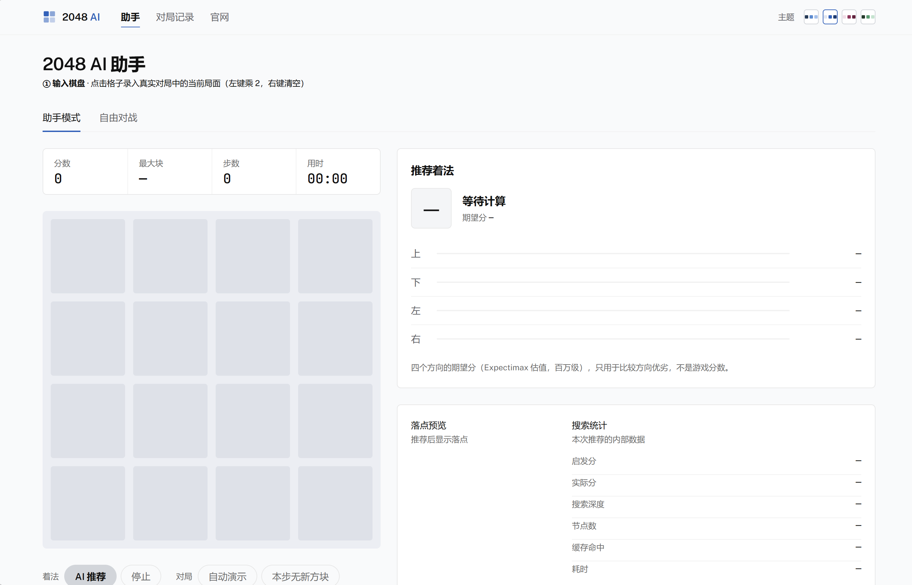
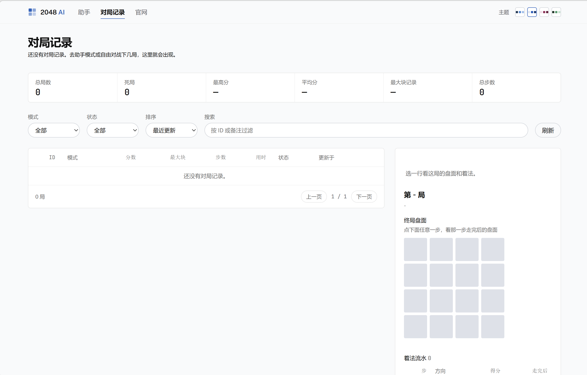
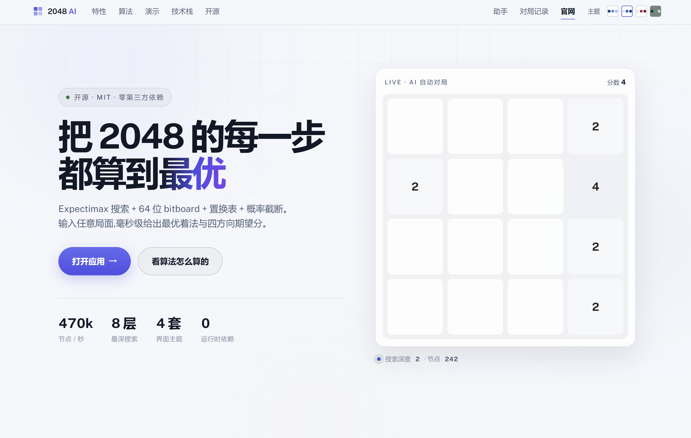
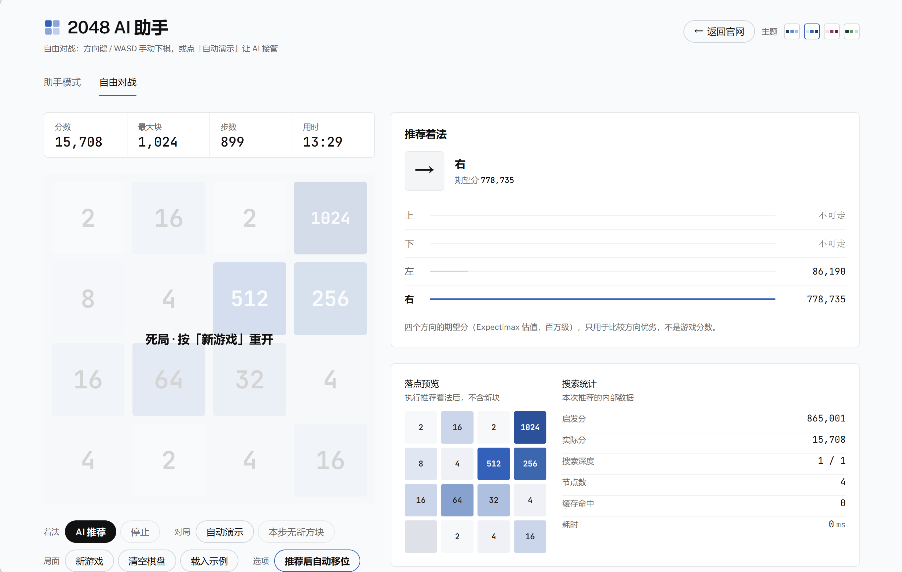
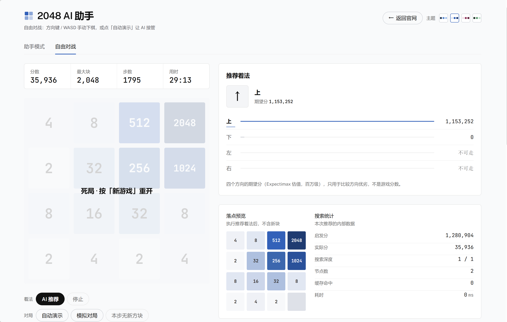
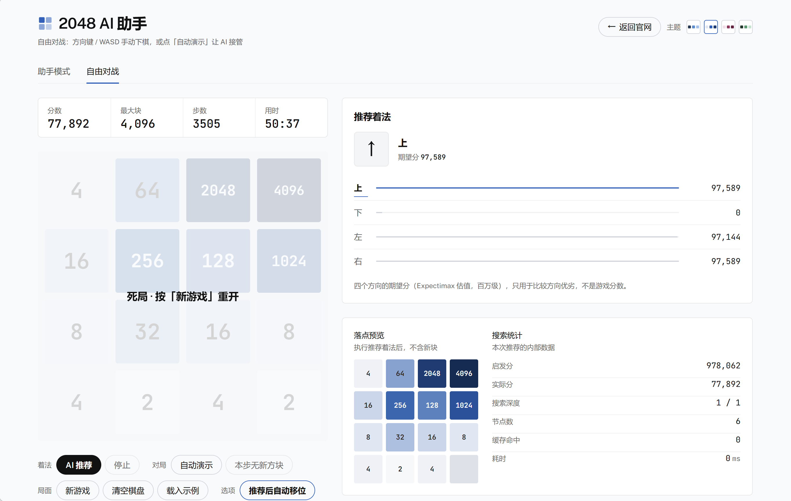

# 2048 AI 网页助手

**输入任意棋盘局面 → 计算最优着法。** 纯 Python 算法后端 + 原生 HTML/JS 前端，零第三方依赖。

作者：[lenyanjgk](https://github.com/lenyanjgk)（冷颜） · MIT License

[](https://opensource.org/licenses/MIT)


- **算法**：Expectimax 搜索 + 64 位 bitboard 棋盘表示 + 65536 项查找表 + 置换表缓存 + 概率截断 + 递进搜索深度
- **交互**：助手模式面向真实对局辅助（AI 出推荐、人走棋、人录新块），另含自由对战与批量模拟
- **主题**：4 套配色（终端 · 暗 / 纸面 · 亮 / 曙色 · 亮 / 苔色 · 暗），三个页面共用同一套，任一页切换另外两页跟着变
- **动效**：方块真实滑动（transform 合成层动画）、合并脉冲、新块弹入、四方向量条、记分跳动，全程尊重 `prefers-reduced-motion`
- **对局记录**：SQLite 落库 + `/admin` 管理页，可筛选、排序、点着法流水逐步回放盘面

## 界面

助手模式主界面（输入棋盘 → AI 推荐 → 四方向期望分 → 搜索统计）：



对局记录管理页（汇总、筛选、排序，右侧详情栏可点流水回放盘面）：



官网落地页首屏：



官网整页（Hero → 特性 → 算法 → 演示 → 技术规格 → 开源区，一张长图，文件 4.3 MB）：


## 快速开始

```bash
cd len-2048-ai
python server.py                # 默认 http://127.0.0.1:8765 ，自动打开浏览器
python server.py --port 9000 --no-browser
```

要求：Python 3.8+（无需安装任何库）。端口也可用环境变量 `PORT` 指定。

## 运行测试

```bash
python test_ai.py      # 算法正确性 / 不变式 / autoplay 回归 / 强度 sanity
python test_db.py      # 对局记录持久层（建表/增删改查/级联删除/汇总/校验）
node test_logic.js     # 前端 JS 移动逻辑 vs Python 引擎对拍（自动生成对拍用例）
node test_flow.js      # 助手模式流程集成测试（含 DOM 桩，无需启动服务）
node test_tilesync.js  # 方块层与棋盘同步回归（自由/助手/切模式）
```

`test_logic.js` 首次运行会调用 `gen_cases.py` 生成 `cases.json`，该文件已被 `.gitignore` 忽略。

## 功能

| 功能 | 说明 |
|---|---|
| **助手模式（默认）** | 真实对局辅助：① 点击格子输入当前棋盘（左键 = 数值乘 2，右键 = 清空）→ ② 点「AI 推荐」看最优着法与四方向评分 → ③ 本地棋盘自动搬到推荐局面并提示走哪个方向，你在真实游戏中走出同样方向 → ④ 点击新出现方块的位置录入数值 → 回到 ② 循环。AI 只出提示，新块由你录入。「推荐后自动移位」可开关：关掉则需自己按方向键 |
| **手动输入局面** | 点击任意格子输入数值（2、4、8…，0 或留空 = 空格），非 2 的幂自动向下取整 —— 这就是"棋盘已有数的情况下计算最优解" |
| **自由对战模式** | 方向键 / WASD 手动下棋（自动出新块），或「自动演示」让 AI 从当前局面自动下到底 |
| **游戏辅助说明** | 界面底部折叠面板，逐个按钮说明它做什么、两种模式怎么用、每个参数什么含义 |
| **对局记录** | 每一局的分数 / 最大块 / 步数 / 用时 / 是否死局 / 当前盘面自动存入 SQLite，管理页 `/admin` 可筛选、排序、回放着法流水、删除 |
| **参数可调** | 深度模式（自适应 / 固定）、固定深度、深度上限、思考预算（200ms~60s 或**不限时长**） |

快捷键：`空格` = AI 推荐，`方向键/WASD` = 走棋。

棋盘录入：**左键 = 数值乘 2**（2→4→8→…→32768→2 循环，32768 是引擎上限），**右键 = 清空**，也可直接键盘输入。

顶栏实时显示**分数 / 最大块 / 步数 / 用时（mm:ss）**。计时从第一步开始，死局自动停表，新游戏、清空棋盘、载入示例、切换模式都会归零。

右上角**主题切换器**可一键换配色，选择存入 `localStorage`，下次打开自动恢复；无记录时跟随系统深浅色偏好。方块颜色由主题色板 + 亮度自适应前景色生成（深底白字、浅底深字），保证数字可读。四套主题共用同一套结构令牌，方块色阶只走单一色相——整屏只有棋盘是彩色的，界面其余部分全是灰阶。

三个页面（助手 / 对局记录 / 官网）共用同一个主题 key，在任一页切换，另外两页立刻跟着变；官网页面的极光、按钮、代码块等也按 key 各有一整套配色，所以官网同样是四套主题而不是只有深浅两档。

按钮分四组固定排列（着法 / 对局 / 局面 / 选项），**位置永不变动，不可用时只置灰**——所以计算过程中布局不会跳动。

思考预算勾选「不限时长」后会取消死线，一直搜到目标深度——中后盘可能等几分钟，计算期间可点「停止」中断；自动演示会自动封顶到 1s/步，不会被这个选项卡死。

助手模式的流程门槛（防状态错乱）：未输入棋盘时点推荐会被拦；走棋后必须先录入新块，才能再次走棋或推荐；新块只能填进空格。死局或规则特殊时用「本步无新方块」按钮跳过等待。

## 项目结构

```
len-2048-ai/
├── ai2048.py          # 算法核心：bitboard + expectimax（零依赖）
├── server.py          # Web 服务：Python 标准库 http.server + JSON API
├── db.py              # 对局记录持久层：SQLite schema + 增删改查（零依赖）
├── games.db           # SQLite 数据库（首次运行自动建表，已被 .gitignore 忽略）
├── test_ai.py         # 自测：对拍 / 不变式 / autoplay 回归 / 强度 sanity
├── test_db.py         # 对局记录持久层自测（python test_db.py）
├── test_logic.js      # 前端 JS 移动逻辑 vs Python 引擎对拍（node test_logic.js）
├── test_flow.js       # 助手模式流程集成测试（node test_flow.js）
├── test_tilesync.js   # 方块层与棋盘同步回归（node test_tilesync.js）
├── gen_cases.py       # 生成对拍用例（test_logic.js 自动调用）
├── static/
│   ├── index.html     # 应用页面结构（/）
│   ├── app.js         # 前端逻辑（棋盘编辑 / 手动与自动对弈 / 推荐渲染 / 落库）
│   ├── themes.js      # 主题系统（4 套配色 + 方块色阶），三个页面共用
│   ├── nav.css        # 共享顶栏 + 共享字体声明，三个页面共用
│   ├── style.css      # 应用样式
│   ├── fonts/         # 自托管 webfont（Public Sans + JetBrains Mono，latin 子集）
│   ├── admin/         # 对局记录管理页（/admin）
│   └── site/          # 官网落地页（/site/）
├── tools/             # 真实浏览器走查脚本（Chrome DevTools Protocol，零依赖）
│   ├── cdp.cjs        #   起 headless Chrome + 连 CDP 的公共部分
│   ├── nav-check.cjs  #   三个页面 × 视口核对共享顶栏与主题联动
│   └── e2e-check.cjs  #   真实浏览器下一局 → 落库 → 管理页核对
├── docs/              # README 里引用的截图
│   ├── 游戏界面.png        # 助手模式主界面
│   ├── 对局记录界面.png     # 对局记录管理页
│   ├── 官网界面.png        # 官网首屏
│   ├── 官网完整界面.png     # 官网整页（长图）
│   └── 15708 / 35936 / 77892.png   # 自动演示三局实录（分数即文件名）
└── LICENSE            # MIT
```

## 浏览器走查（可选）

页面没有构建步骤，走查也直接用 Node 驱动 headless Chrome，不引依赖（Node 18+）：

```bash
python server.py &                                    # 先起服务
node tools/nav-check.cjs out 1440 900 neon            # 顶栏 + 主题联动
node tools/e2e-check.cjs  out 1440 900                # 端到端落库与管理页
```

Chrome 路径按平台自动找，找不到就用 `CHROME=/path/to/chrome` 指定；端口默认 8765，可用 `PORT` 覆盖。

## API

所有接口均为 `POST`，`Content-Type: application/json`。

### `/api/best_move` — 单步推荐

请求：
```json
{
  "board": [[1024,512,256,0],[64,32,16,8],[4,8,16,0],[2,4,0,0]],
  "depth_mode": "adaptive",   // adaptive=递进深度 max(3, 不同数字-2)；fixed=固定深度
  "fixed_depth": 4,           // fixed 模式生效
  "max_depth": 8,             // 深度上限
  "time_budget_ms": 3000      // 思考预算；0 = 不限时长
}
```
响应（节选）：
```json
{
  "ok": true, "best": 0, "best_name": "up", "arrow": "↑",
  "scores": [1426628.1, 1315818.5, 0.0, 1376520.8],   // 启发分，0=非法
  "valid_moves": [0, 1, 3],
  "board_after": [[1024,512,256,8],[64,32,32,0],[4,8,0,0],[2,4,0,0]],
  "heur": 1412225.8, "actual_score": 15688,
  "stats": {"depth": 5, "nodes": 797783, "cache_hits": 42361,
            "elapsed_ms": 2003, "timed_out": true, "target_depth": 7}
}
```

### `/api/auto` — 从当前局面自动下完

```json
{"board": [[...]], "max_steps": 200, "time_budget_ms": 300}
→ {"steps": [{"move": 0, "move_name": "up", "arrow": "↑", "gain": 16,
              "score": 16, "board": [[...]], "max_tile": 64}, ...],
    "final_score": 12345, "max_tile": 1024, "game_over": false}
```

### `/api/simulate` — 批量模拟

```json
{"games": 5, "seed": 42, "depth_mode": "adaptive", "time_budget_ms": 300}
→ {"mean_score": 8000.0, "max_score": 15000, "min_score": 3000,
   "tile_dist": {"512": 1, "1024": 3, "2048": 1}, "results": [[score, max_tile], ...]}
```

## 对局记录

每开一局自动建一条记录，之后每走一步追加一条着法流水并更新主表。**全部静默失败**——数据库不可用也绝不影响下棋。

### 表结构（`db.py`，SQLite，首次运行自动建表）

```sql
-- 一行 = 一局。board 是 4x4 JSON，is_over 区分死局/进行中
CREATE TABLE games (
    id          INTEGER PRIMARY KEY AUTOINCREMENT,
    mode        TEXT    NOT NULL DEFAULT 'assistant',   -- assistant | free
    score       INTEGER NOT NULL DEFAULT 0,
    max_tile    INTEGER NOT NULL DEFAULT 0,             -- 由盘面自动算出
    moves       INTEGER NOT NULL DEFAULT 0,             -- 记分板步数
    elapsed_ms  INTEGER NOT NULL DEFAULT 0,
    is_over     INTEGER NOT NULL DEFAULT 0,             -- 0 进行中 / 1 死局
    board       TEXT    NOT NULL DEFAULT '[]',          -- JSON 4x4，当前/终局局面
    note        TEXT    NOT NULL DEFAULT '',
    created_at  TEXT    NOT NULL,
    updated_at  TEXT    NOT NULL,                       -- 一直往前推，"当前局"= 最近更新的行
    ended_at    TEXT
);

-- 一行 = 一步。board_after 是这步走完后的盘面，可逐步回放
CREATE TABLE moves (
    id             INTEGER PRIMARY KEY AUTOINCREMENT,
    game_id        INTEGER NOT NULL REFERENCES games(id) ON DELETE CASCADE,
    step_no        INTEGER NOT NULL,
    direction      INTEGER NOT NULL,                    -- 0上 1下 2左 3右
    direction_name TEXT    NOT NULL,
    gain           INTEGER NOT NULL DEFAULT 0,
    score_after    INTEGER NOT NULL DEFAULT 0,
    board_after    TEXT    NOT NULL DEFAULT '[]',
    source         TEXT    NOT NULL DEFAULT 'manual',   -- manual | ai | autoshift
    created_at     TEXT    NOT NULL
);
```

索引：`games(updated_at DESC)`、`games(mode, updated_at DESC)`、`games(is_over, updated_at DESC)`、`moves(game_id, step_no)`。
连接按线程各自持有（`threading.local`，`ThreadingHTTPServer` 每请求一个线程），开 WAL 模式让管理页读的时候应用还能写。
删一局会级联删掉它的着法流水。

### 管理页 `GET /admin`

- **汇总条**：总局数 / 死局 / 最高分 / 平均分 / 最大块记录 / 总步数，一条容器用 1px 线切开
- **表格**：ID / 模式 / 分数 / 最大块 / 步数 / 用时 / 状态 / 更新于 / 删除，数字右对齐等宽，行选中是同一条 1px accent 线
- **筛选**：模式、状态、排序（最近更新 / 分数 / 步数），外加按 ID 或备注搜索
- **详情栏**（右侧固定 384px）：盘面 + 该局元数据 + 着法流水；**点流水里任意一步，盘面切到那一步走完后的局面**，可逐步回放
- 手机端表格在自己的框里横向滚动，页面本身不横滚

### 记录接口

| 方法 | 路径 | 说明 |
|---|---|---|
| GET | `/api/games?mode=&is_over=&order=&limit=&offset=` | 列表 + 总数 |
| GET | `/api/games/<id>` | 一局 + 它的着法流水 |
| GET | `/api/games/summary` | 汇总统计 |
| POST | `/api/games` | 新建一局 |
| POST | `/api/games/upd` | 局部更新（只更新传了的字段） |
| POST | `/api/games/move` | 追加一步着法，并对齐主表 |
| POST | `/api/games/del` | 删除一局（含级联删流水） |

`elapsed_ms` 在每一步着法里都跟着读进去，所以管理页的"用时"不会一直是 00:00；离开页面前还会用 `keepalive` 请求补最后一次。

## 算法设计

### 棋盘表示：64 位 bitboard

整个 4×4 棋盘压进一个 64 位整数，每格 4 bit 存 `rank = log2(数值)`（0=空，1=2，2=4 … 15=32768）。这样一次移动就是对整个棋盘的一趟位运算，且棋盘状态可直接当哈希键做置换表。

### 预计算查找表

`init_tables()` 预生成 6 张 65536 项表：

| 表 | 作用 |
|---|---|
| `row_left_table` / `row_right_table` | 一行（16 bit）→ 左右移动后的 XOR 增量 |
| `col_up_table` / `col_down_table` | 一列（16 bit）→ 上下移动后的 XOR 增量 |
| `score_table` | 一行 → 该行真实分 |
| `heur_score_table` | 一行 → 该行启发分 |

一行只有 65536 种可能，全部预先算好，运行时查表即可，避免每次递归都重算滑动与合并。

### 启发式评分

每行按下面公式打分，`score_heur_board` 再把 4 行 + 4 列（转置后再 4 行）求和：

```
heur_row = 200000                      # 失败重罚：盘面越糟跌得越狠
         + 270  × 空格数
         + 700  × 可合并对数
         − 47   × min(左单调性, 右单调性)
         − 11   × Σ rank^3.5
```

四项分别对应四个 2048 核心策略：**保空格**（活下去）、**造可合并**（有东西吃）、**维持单调**（大数集中到一角）、**压制总数**（别让盘面太肥）。

### Expectimax 搜索

2048 是"玩家 + 随机出块"的不完全信息动态博弈，玩家走位是确定性的（取 max），出块是随机的（取期望），所以用 expectimax 而不是 minimax：

```
move_node(b)      = max over 4 个方向的 tilechoose(移动后棋盘)
tilechoose(b, p)  = Σ 每个空格 × {2: 0.9, 4: 0.1} × move_node(放块后棋盘) × 概率
```

### 两个关键剪枝/加速

**概率截断**：`tilechoose` 携带累计概率 `cprob`，低于 `0.0001` 的分支直接按启发分截止。出块位置的概率乘积衰减极快，这条能把搜索树砍掉一大截而不明显损失强度。

**递进深度**：`depth_limit = max(3, 盘面不同数字种数 − 2)`。开局数字种类少、空格多、分支爆炸，搜深了又慢又不准；残局数字种类多、空格少、分支收缩，值得深搜。同一套参数自动适配开局与残局。

**置换表**：缓存 `(深度, 启发分)`，仅当记录深度 ≤ 当前深度才命中，避免用浅层结果冒充深层结果。

## 纯 Python 落地的两个关键处理

1. **有界循环**：编译型语言可依赖定宽整数溢出归零来结束"`x <<= 4`"这类位移循环，Python 大整数无上限会死循环，必须显式限制次数（`for _ in range(16)`）。
2. **迭代加深 + 死线检查**：从深度 1 逐层加深，递归内周期性检查死线，超时抛 `_SearchTimeout` 回退到最近完成的深度。这样任何机器都能在预算内返回推荐，且浅层结果始终可用。置换表**每个深度层新建**——跨层共享会让浅层缓存污染深层，迭代加深会被彻底废掉。

## 实测数据

| 项目 | 成绩 |
|---|---|
| 位运算正确性 | `execute_move` 与朴素实现在 300+ 随机棋盘上逐方向对拍零偏差；`count_empty`/`score_board`/移动增益不变式各 1000 局验证通过 |
| 前后端一致性 | 前端 JS 移动逻辑与 Python 引擎在 400 棋盘 × 4 方向上零偏差（`node test_logic.js`） |
| 对局状态转移 | autoplay 不变式回归：每步恰好生成一块、面值守恒、分数守恒（`test_ai.py`） |
| 单步推荐（中局，3s 预算） | 完成深度 5~6，30~80 万节点，缓存命中 1.5~7 万 |
| 节点速率 | ≈47 万节点/秒（纯 Python，查找表 + 内联热路径） |
| AI 强度（150ms/步） | 300 步稳定合成 **512**（`test_ai.py` 回归，`max_tile >= 64` 是硬断言） |

**关于"得分 4784"这类数字**：autoplay 带 150ms 死线，迭代加深实际搜到几层取决于当时机器快慢，所以同一份种子跑两遍分数也不一样——实测同一 seed 三连跑是 4548 / 4568 / 4536。`test_ai.py` 因此只把**不变式**和**分数下限**设为断言，不锁具体分值。下面三张是「不限时长」思考预算下的真实截图，分步骤慢慢磨，所以能走得更远。

### 自动演示实况

「自动演示」让 AI 从空盘自己下到底，方块真实滑动。三张都是同一套参数、不同随机种子、勾选「不限时长」后的实录（数据取自截图里的记分板与搜索统计）：

| 分数 | 最大块 | 步数 | 用时 |
|---:|---:|---:|---:|
| 15,708 | 1,024 | 899 | 13:29 |
| 35,936 | 2,048 | 1,795 | 29:13 |
| 77,892 | 4,096 | 3,505 | 50:37 |







时间盒内通常达到 expectimax 深度 4~6，150ms/步即可稳定合成 512、冲击 1024，作为"任意局面求推荐"的助手够用；勾选「不限时长」在残局能真正搜到 8 层。

## 已知限制

- 最大块支持到 32768（rank 15，nibble 上限）
- `/api/simulate`（批量模拟，用于命令行测强度）是阻塞式请求，`games` 大时会等较久；它只走 API，界面里没有入口
- 未做多进程/多线程加速（Python GIL 下收益有限）
- `games.db` 是单机 SQLite 文件，没有用户体系与鉴权；管理页假定只有本机能访问
- 落库失败一律静默（不弹窗、不打断下棋），所以数据库挂了你不会立刻知道，只会发现 `/admin` 里没有新记录

## 致谢

启发式权重与查找表结构的定型参考了社区中成熟的 2048 AI 公开实现（[nneonneo/2048-ai](https://github.com/nneonneo/2048-ai)，MIT）。本项目的 Python 引擎、迭代加深与时间盒调度、Web 服务与全部交互流程均为独立实现。

## License

[MIT](LICENSE) · Copyright (c) 2026 lenyanjgk（冷颜）
